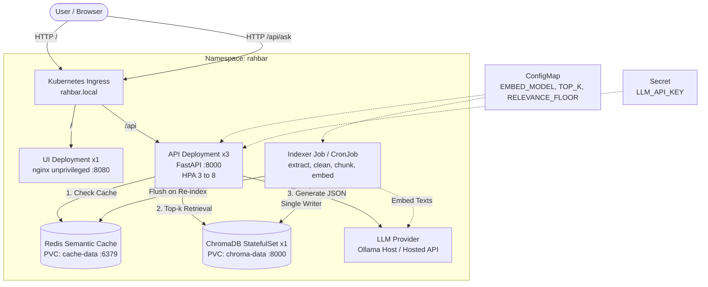

# RAHBAR: Grounded RAG on Kubernetes

[](https://github.com/organization/rahbar/actions/workflows/ci.yml)
[](LICENSE)
[](https://kubernetes.io/)
[](https://www.trychroma.com/)

RAHBAR is a production-grade, grounded question-answering system deployed on Kubernetes over real institutional policy documents from FAST-NUCES (`nu.edu.pk`). It adheres strictly to the core principle: **fluency is not factuality**. The system answers exclusively using retrieved contextual evidence, cites sources with file, section, and page coordinates, and abstains honestly when documentation is lacking.

---

## Architecture Diagram

The system enforces a strict single-writer, multi-reader architecture. The indexing pipeline runs as an isolated Kubernetes Job writing to ChromaDB, while 3 API replicas read from the index on every question.



---

## API Endpoints

The API service runs within the `rahbar` namespace and exposes the following contract:

| Method | Route | Purpose | Behavior & Dependencies |
| :--- | :--- | :--- | :--- |
| GET | `/healthz` | Liveness Probe | Answers if the FastAPI process is alive. Never touches Chroma, Redis, or LLM. |
| GET | `/readyz` | Readiness Probe | Returns 200 only if Chroma is reachable, collection is non-empty, Redis is reachable, and the embedding model matches `EMBED_MODEL`. Returns 503 otherwise. |
| GET | `/metrics` | Prometheus Metrics | Exposes request latency, retrieval latency, generation latency, cache hits/misses, abstention counts, and token counters. |
| POST | `/api/ask` | Query & Grounding | Accepts `{"question": "..."}` (3 to 500 characters). Enforces semantic cache check, top-k retrieval with version filtering, relevance floor check, schema-constrained generation with one retry, and citation verification. |

---

## Cluster Initialization & Prerequisites

Start a local Kubernetes cluster using minikube with the Calico network plugin (required for enforcing `NetworkPolicy` manifests):

```bash
# 1. Start minikube with Calico CNI, 6GB RAM, and 4 CPUs
minikube start --driver=docker --cni=calico --memory=6144 --cpus=4

# 2. Enable necessary minikube addons
minikube addons enable metrics-server
minikube addons enable ingress

# 3. Configure local DNS resolution for the Ingress host
echo "$(minikube ip) rahbar.local" | sudo tee -a /etc/hosts
```

If utilizing host-based Ollama, configure Ollama to listen across all interfaces:
```bash
export OLLAMA_HOST=0.0.0.0
ollama serve
ollama pull llama3.2:3b
ollama pull nomic-embed-text
```

---

## Deployment: Exact Apply Order

To guarantee clean initialization without race conditions, apply the Kubernetes manifests in the following order:

```bash
# 1. Create the dedicated namespace
kubectl apply -f k8s/base/namespace.yaml

# 2. Create the Secret from the command line (never commit real credentials)
kubectl create secret generic rahbar-secret -n rahbar \
  --from-literal=LLM_API_KEY="${LLM_API_KEY:-placeholder}" \
  --dry-run=client -o yaml | kubectl apply -f -

# 3. Apply service accounts and configuration
kubectl apply -f k8s/base/serviceaccount.yaml
kubectl apply -f k8s/base/configmap.yaml

# 4. Deploy data tiers (Chroma StatefulSet and Redis Cache)
kubectl apply -f k8s/base/services.yaml
kubectl apply -f k8s/base/chroma-statefulset.yaml
kubectl apply -f k8s/base/redis-deployment.yaml

# 5. Wait for Chroma and Redis to become ready
kubectl wait --for=condition=ready pod -l app=chroma -n rahbar --timeout=120s
kubectl wait --for=condition=ready pod -l app=redis -n rahbar --timeout=60s

# 6. Run the Indexer Job to build the initial vector store
kubectl apply -f k8s/base/indexer-job.yaml
kubectl wait --for=condition=complete job/indexer -n rahbar --timeout=300s

# 7. Apply the API Deployment, UI Deployment, Ingress, HPA, and NetworkPolicy
kubectl apply -f k8s/base/api-deployment.yaml
kubectl apply -f k8s/base/ui-deployment.yaml
kubectl apply -f k8s/base/ingress.yaml
kubectl apply -f k8s/base/hpa.yaml
kubectl apply -f k8s/base/networkpolicy.yaml
kubectl apply -f k8s/base/reindex-cronjob.yaml

# 8. Verify rollout status of API and UI replicas
kubectl rollout status deployment/api -n rahbar
kubectl rollout status deployment/ui -n rahbar
```

Alternatively, deploy using Kustomize overlays:
```bash
kubectl apply -k k8s/overlays/dev
```

---

## How to Run the Indexer & Re-Index

Because indexing is strictly decoupled from API startup (ADR 0001), re-indexing changes to university policies is executed on-demand without redeploying the API:

```bash
# Option A: Trigger a manual re-index from the CronJob template
kubectl create job --from=cronjob/reindex manual-reindex-$(date +%s) -n rahbar

# Option B: Run locally during development
python -m pipeline.run --dummy       # Week 1 dummy mode (3 fake chunks)
python -m pipeline.run               # Production pipeline (extract, clean, chunk, embed, store)
```

---

## Evaluation & Regression Gating

Run the evaluation harness against the running cluster to score the golden question set:

```bash
# Run against the Ingress endpoint
python eval/run_eval.py --api http://rahbar.local --golden eval/golden.yaml

# Run against fixture documents for CI
python eval/run_eval.py --api http://localhost:8000 --golden eval/fixtures/golden.fixture.yaml
```

CI enforces three non-negotiable quality gates:
1. `recall@5` does not drop more than 5 percentage points below committed baseline.
2. `abstention_correctness` is strictly 100% (must-abstain questions must never answer from context).
3. `citation_validity` is at least 95% (every citation must match an actually retrieved chunk).
